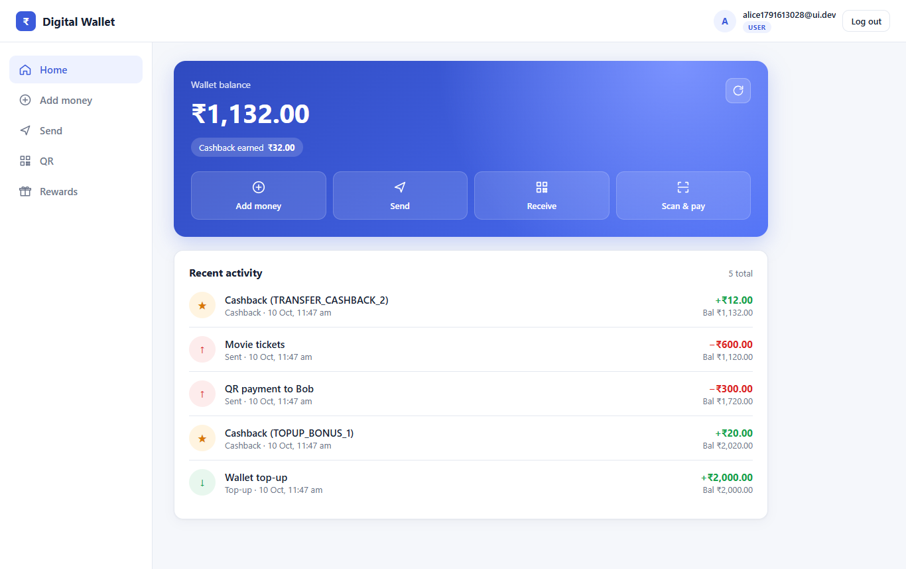
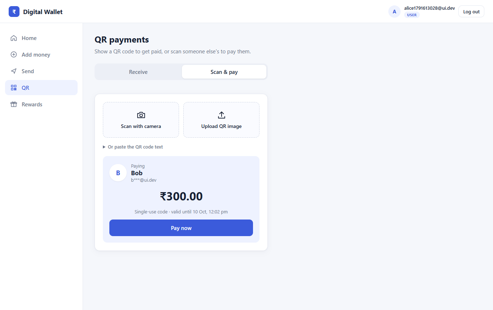
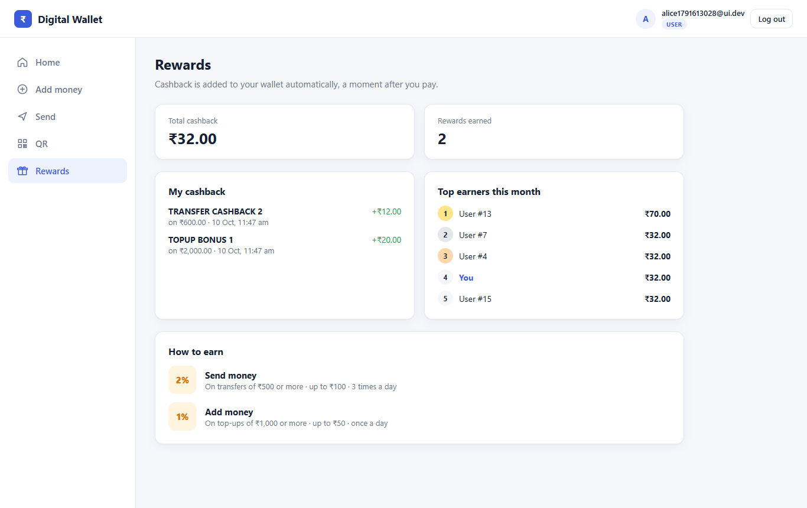
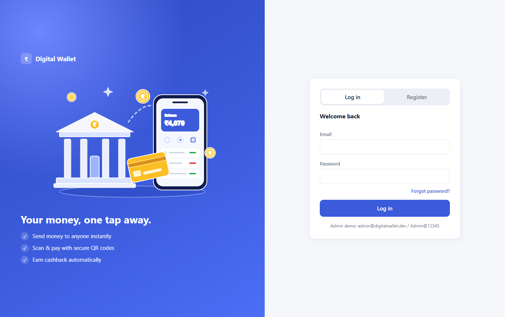
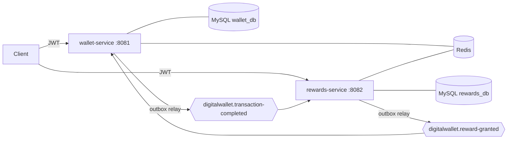

# Digital Wallet: event-driven wallet and cashback platform

[](https://github.com/Vikas-l/digital-wallet/actions/workflows/ci.yml)
    

This project is the backend of a digital wallet with an automated cashback engine, similar to the wallet and rewards part of Paytm, PhonePe or Amazon Pay. Users register, add money, send money to each other, and pay by scanning QR codes (like UPI scan-and-pay). A rule engine grants cashback asynchronously over Kafka. Admins manage cashback campaigns and can draft them from plain English with an LLM.

It is built as two Spring Boot microservices. The focus is the things that make money-handling systems correct under real conditions: concurrency, retries, duplicate messages, and partial failures.

**Stack:** Java 21 · Spring Boot 3.5 · Spring Security (JWT) · Spring Data JPA / Hibernate · MySQL 8.4 · Flyway · Apache Kafka 3.9 (KRaft) · Redis 7 (Redisson) · Spring AI · Spring Mail · ZXing (QR codes) · Testcontainers · k6 · Docker · GitHub Actions

| Home | Scan and pay |
|---|---|
|  |  |
| **Rewards** | **Login** |
|  |  |

---

## Architecture



| Service | Responsibility |
|---|---|
| **wallet-service** | Registration, login and password reset (issues JWTs), wallets, top-ups, P2P transfers, QR payments, double-entry ledger, statement, credits cashback |
| **rewards-service** | Consumes completed transactions, evaluates cashback rules, records rewards, admin rule API, AI rule drafting, leaderboard |
| **digital-wallet-common** | Event contracts (Java records) shared over Kafka |

### What happens when Alice sends ₹1000 to Bob

1. `POST /api/wallets/me/transfers` with an `Idempotency-Key` header.
2. The Redis rate limiter checks Alice's transfers-per-minute count.
3. The idempotency guard checks the key. If the request was already processed, the stored result is replayed.
4. One DB transaction locks both wallet rows (`SELECT … FOR UPDATE`, always in ascending id order), debits Alice, credits Bob, writes the transaction, writes two ledger entries (DEBIT and CREDIT), and writes a `TransactionCompleted` event into the **outbox table**.
5. The outbox relay publishes the event to Kafka, keyed by userId.
6. rewards-service consumes it and matches `TRANSFER_CASHBACK_2` (2%, max ₹100, 3 per day), giving ₹20. In one transaction it stores the reward, the processed-event marker and a `RewardGranted` outbox event.
7. wallet-service consumes `RewardGranted` and credits ₹20 exactly once.

---

## Engineering highlights

| Concern | How it is handled |
|---|---|
| **No lost or double money** | `BigDecimal` with scale 2, pessimistic row locks, `@Version` as a safety net, and a DB `CHECK (balance >= 0)` |
| **No deadlocks** | Wallet rows are always locked in ascending id order |
| **Safe retries** | `Idempotency-Key` header: the DB unique key `(user, key)` is the source of truth, a Redis `SET NX` guard blocks concurrent duplicates, and a request fingerprint stops a key being reused for a different request (422) |
| **DB and Kafka consistency** | Transactional outbox, relayed with `FOR UPDATE SKIP LOCKED` so several instances can publish in parallel |
| **Duplicate Kafka messages** | Idempotent consumers (a `processed_events` table committed with the business change) plus unique constraints |
| **Poison messages** | 3 retries, then a `<topic>.DLT` dead-letter topic; bad JSON is not retried |
| **Ordering** | Events are keyed by userId, so one user's events are processed in order on one partition. This also prevents daily-limit races |
| **No reward loops** | Reward credits do not emit `TransactionCompleted` |
| **Auditability** | Double-entry ledger; the test suite checks the ledger sum always equals the balance |
| **Security** | Stateless JWT (HS256) with USER/ADMIN roles; admin-only rule management; BCrypt passwords |
| **Logout with JWTs** | Token id (`jti`) goes into a Redis denylist with TTL = remaining token life, checked by both services |
| **Forgot password** | 6-digit OTP by email, stored only as a hash in Redis for 10 minutes; 5 wrong tries destroy it; the same answer whether or not the email exists; a reset logs the user out on every device |
| **Overload** | Pool exhaustion or a long lock wait answers `503 SERVICE_BUSY` + `Retry-After` instead of 500; lock waits capped at 5 s; safe to retry thanks to idempotency keys |
| **Load tested** | k6 staircase from 10 to 200 concurrent users: 0 errors, 0 double charges, 11 data-consistency checks all 0. See [docs/PERFORMANCE.md](docs/PERFORMANCE.md) |
| **Errors** | RFC 7807 `application/problem+json` with stable codes such as `INSUFFICIENT_FUNDS` and `IDEMPOTENCY_KEY_REUSED` |
| **Observability** | Actuator health, liveness and readiness probes, Prometheus metrics |

### Where Redis is used, and why

| Use | Redis feature | Why Redis |
|---|---|---|
| Idempotency guard | `SET key NX EX 30` | Atomic "first one wins" across all instances |
| Transfer rate limiting | `INCR` + `EXPIRE` (fixed window) | Shared counter for every instance; keys clean themselves up |
| JWT logout / revocation | Key with TTL | Self-cleaning denylist, shared by both services |
| Active-rule cache | String (JSON) + TTL, cache-aside | Rules are read on every event but rarely change; evicted after commit on admin changes |
| Monthly leaderboard | Sorted set `ZINCRBY` / `ZREVRANGE` | O(log n) updates and top-N reads |
| Single-use QR claim | `SET NX` with TTL until the QR expires | Two payers scanning the same bill: exactly one wins; released if the payment fails |
| Password-reset OTP | Hash + attempt counter with TTL | One-time code that expires on its own; brute force is capped |
| "Logged out everywhere" after a reset | Per-user "tokens valid after" time with TTL | Both services reject every older token |

MySQL stays the source of truth. If Redis is unavailable, the rule cache falls back to the database.

### QR payments (scan and pay)

1. **Create** (`POST /api/qr`): the payee gets a QR code (PNG) holding a token `DW1.<claims>.<signature>`. The claims are the QR id, the payee, an optional fixed amount, a single-use flag and an expiry. The token is signed with **HMAC-SHA256** using a server-side key, so editing the amount or payee breaks the signature. Creating a QR needs no database write.
2. **Scan** (`POST /api/qr/preview`): the payer's app verifies the code and shows the payee's name, masked email and amount before paying.
3. **Pay** (`POST /api/qr/pay`): reuses the transfer flow (locks, ledger, idempotency key, rate limit, outbox), so cashback rules apply as well.

A single-use bill can't be paid twice. A Redis `SET NX` claim decides between concurrent payers, and a unique DB column linking the QR id to its transaction is the final guarantee. If a payment fails (for example insufficient funds), the claim is released so the bill can still be paid. Reusable QR codes (`"singleUse": false`, e.g. a shop counter) let the payer enter the amount.

### Forgot password (OTP by email)

1. `POST /api/auth/password/forgot` with the email. If the account exists, a random 6-digit code is emailed; the answer is identical either way, so nobody can find out who has an account. Max 3 requests per 15 minutes per email.
2. `POST /api/auth/password/reset` with the email, code and new password. The code is compared in constant time with the stored SHA-256 hash, works once, and expires after 10 minutes; after 5 wrong tries it is destroyed.
3. On success, a per-user "tokens valid after" time is written to Redis, so **every token issued before the reset is rejected by both services**: the user is logged out on all devices.

Locally, emails are caught by **Mailpit** (a fake SMTP server in Docker Compose): open **http://localhost:8025** to read them. In production, `spring.mail.*` would point to a real mail provider.

### Web UI

A small single-page client (plain HTML, CSS and JavaScript, no framework or build step) is served by wallet-service from `src/main/resources/static`. It is a demo client for the APIs; the project's focus is the backend.
- Screens: Home (balance and recent activity), Add money, Send, QR (receive / scan and pay), Rewards, Admin (rules). The login page includes registration and "Forgot password?".
- QR codes are decoded **in the browser** with jsQR (stored locally under `static/vendor`): scan with the **webcam**, upload an image, or paste the code text. Browsers allow the camera only on `localhost` or HTTPS, after the user agrees.
- The page is served from port 8081 and calls rewards-service on 8082, so rewards-service enables **CORS** for that origin only (`CORS_ALLOWED_ORIGINS`).
- The JWT lives in `sessionStorage` (per tab, cleared when the tab closes). Each money action sends a fresh `Idempotency-Key`.

### AI rule drafting (Spring AI)

`POST /api/rules/ai-draft` with `{"instruction": "5% cashback on transfers above 2000, max 150, twice a day"}` returns a typed `RuleRequest` draft. The LLM output is parsed into a Java record and validated with the same Bean Validation rules as a manual request. It is **never saved automatically**: an admin reviews it and saves it with `POST /api/rules`. Any OpenAI-compatible provider works (OpenAI, Groq, a local Ollama); the feature is off by default.

---

## Run it

Requirements: JDK 21 and Docker. Maven is not needed; use the wrapper.

```bash
# 1. infrastructure: MySQL, Redis, Kafka, Mailpit (about 1.2 GB RAM)
docker compose up -d

# 2. run both services (two terminals)
./mvnw -pl wallet-service -am spring-boot:run
./mvnw -pl rewards-service -am spring-boot:run

# or build and run everything in Docker instead of step 2
docker compose --profile app up -d --build
```

- **Web app: http://localhost:8081**. Register, add money, send money, create and scan QR codes, and see your statement, cashback and the leaderboard. Log in as the admin to manage cashback rules. Use two browser tabs to be two different users.
- Test email inbox (Mailpit, for password-reset codes): http://localhost:8025
- Swagger UI: http://localhost:8081/swagger-ui.html and http://localhost:8082/swagger-ui.html
- Bootstrap admin: `admin@digitalwallet.dev` / `Admin@12345` (demo only; override with `ADMIN_EMAIL` / `ADMIN_PASSWORD`)
- End-to-end demo (Windows): `powershell -ExecutionPolicy Bypass -File scripts\demo.ps1`
- Load test with consistency checks (Windows, ~8 minutes, isolated from your data): `powershell -ExecutionPolicy Bypass -File scripts\load-test.ps1`
- Kafka UI (optional): `docker compose --profile tools up -d`, then http://localhost:8090

To enable AI drafting: `AI_ENABLED=true OPENAI_API_KEY=... [OPENAI_BASE_URL=https://api.groq.com/openai AI_MODEL=llama-3.3-70b-versatile]`.

### Tests

```bash
./mvnw verify      # needs Docker: integration tests start real MySQL, Kafka, Redis and Mailpit via Testcontainers
```

59 tests, including:
- 20 concurrent transfers against a ₹100 balance: exactly 10 succeed and the balance never goes negative
- An idempotent retry returns the original transaction and the money moves once
- A duplicate Kafka delivery is credited once
- The outbox publishes to Kafka with the userId partition key
- Daily limits, rule priority, the validity window, round-down and caps in the rule engine
- A new admin rule takes effect immediately (cache eviction)
- Logout makes the token invalid
- The web UI is served without login, and CORS allows only the UI's origin
- Password reset with a real email read from Mailpit: old tokens stop working, the code works once, 5 wrong guesses destroy it, unknown emails get the same answer, requests are rate limited
- The same email can't register twice, whatever the letter case
- QR codes: the generated PNG decodes back to the signed payload; a tampered or expired code is rejected; a single-use bill is paid once, even on retry; a failed payment releases the bill

---

## API overview

| Method | Path | Who | Notes |
|---|---|---|---|
| POST | `/api/auth/register` · `/api/auth/login` | public | Returns a JWT |
| POST | `/api/auth/logout` | user | Revokes the token |
| POST | `/api/auth/password/forgot` | public | Emails a 6-digit OTP (same answer for unknown emails) |
| POST | `/api/auth/password/reset` | public | Email + OTP + new password; logs out all devices |
| GET | `/api/wallets/me` | user | Balance |
| GET | `/api/wallets/me/statement?page=0&size=20` | user | Ledger, newest first |
| POST | `/api/wallets/me/top-ups` | user | `Idempotency-Key` required |
| POST | `/api/wallets/me/transfers` | user | `Idempotency-Key` required, rate limited |
| POST | `/api/qr` | user | Create a signed QR code to receive money (payload + PNG) |
| POST | `/api/qr/image` | user | Render a QR payload as a PNG |
| POST | `/api/qr/preview` | user | Scan: verify and show payee and amount |
| POST | `/api/qr/pay` | user | Pay a QR code; `Idempotency-Key` required |
| GET | `/api/rewards/me` · `/api/rewards/me/summary` | user | Cashback history and total |
| GET | `/api/rewards/leaderboard?limit=10` | user | Top earners this month |
| GET/POST/PUT | `/api/rules` · `/api/rules/{id}` | admin | Manage rules |
| PATCH | `/api/rules/{id}/status` | admin | Activate or deactivate |
| POST | `/api/rules/ai-draft` | admin | LLM draft, not saved |

---

## Possible next steps

API gateway (Spring Cloud Gateway) as a single entry point · refresh tokens · Debezium CDC instead of the polling outbox relay · OpenTelemetry tracing across Kafka hops · Kubernetes manifests with the existing readiness and liveness probes · multi-currency wallets.

---

## Third-party libraries

Besides the Spring ecosystem: [ZXing](https://github.com/zxing/zxing) (QR generation, Apache-2.0), [jsQR](https://github.com/cozmo/jsQR) (QR decoding in the browser, Apache-2.0, bundled under `wallet-service/src/main/resources/static/vendor`), [Redisson](https://github.com/redisson/redisson) (Apache-2.0), [Mailpit](https://github.com/axllent/mailpit) and [k6](https://github.com/grafana/k6) for local development and load testing.

